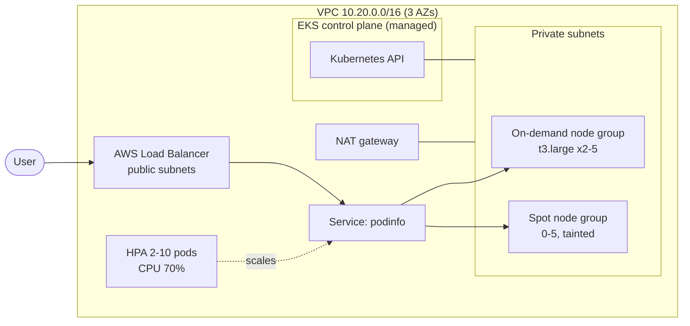

# 01 · AWS EKS Platform with Terraform

> **Hands-on lab.** A reference build for learning and demonstration, not client code.

A production-style Amazon EKS cluster built with Terraform: a three-AZ VPC, an on-demand node group for
baseline load, a spot node group for cheap burst capacity, and a sample app that scales and heals itself.



## What it shows

- **Infrastructure as Code** with the community `terraform-aws-modules` VPC and EKS modules.
- **Cost-aware capacity**: a spot node group behind a taint, so only workloads that opt in run there.
- **Self-healing and autoscaling**: readiness/liveness probes, a HorizontalPodAutoscaler and a PodDisruptionBudget.
- **Resilience**: replicas spread across availability zones with topology spread constraints.
- **Secure defaults**: private worker nodes, non-root containers with a read-only filesystem.

## Layout

```
terraform/   VPC + EKS cluster + node groups
k8s/         sample app: Deployment, Service, HPA, PDB
docs/        architecture and design decisions
```

## Run it

```bash
cd terraform
terraform init
terraform apply                      # about 15 minutes
$(terraform output -raw configure_kubectl)

kubectl apply -f ../k8s/sample-app.yaml
kubectl -n demo get pods,hpa
kubectl -n demo get svc podinfo      # EXTERNAL-IP is the load balancer hostname
```

Generate load to watch the HPA scale out:

```bash
kubectl -n demo run load --rm -it --image=busybox:1.36 -- \
  sh -c 'while true; do wget -qO- http://podinfo/; done'
kubectl -n demo get hpa podinfo -w
```

## Clean up

```bash
kubectl delete -f ../k8s/sample-app.yaml
terraform destroy
```

**Cost:** the EKS control plane, NAT gateway and nodes are billed hourly. Destroy the lab when you're done.

See [docs/ARCHITECTURE.md](docs/ARCHITECTURE.md) for design decisions.
