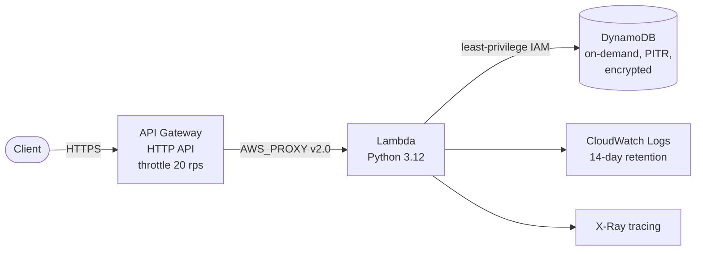

# 02 · AWS Serverless API

> **Hands-on lab.** A reference build for learning and demonstration, not client code.

A fully serverless REST API: **API Gateway (HTTP API) → Lambda (Python 3.12) → DynamoDB**, built with Terraform.
No servers to patch, pay per request, and it scales to zero.



## What it shows

- **Serverless architecture** with routes `GET/POST /items` and `GET/DELETE /items/{id}`.
- **Least-privilege IAM**: the function can touch only its own table and log group.
- **Reliability**: on-demand DynamoDB with point-in-time recovery, and API throttling against spikes.
- **Observability**: structured logs with set retention, and X-Ray tracing on every request.

## Layout

```
terraform/   DynamoDB, IAM, Lambda, API Gateway
src/app.py   Lambda handler (routing + validation)
docs/        architecture and design decisions
```

## Run it

```bash
cd terraform
terraform init
terraform apply
API=$(terraform output -raw api_url)

curl -s -X POST "$API/items" -d '{"name":"first item"}'
curl -s "$API/items"
```

## Clean up

```bash
terraform destroy
```

**Cost:** close to zero at lab traffic. Lambda, API Gateway and on-demand DynamoDB all bill per request.

See [docs/ARCHITECTURE.md](docs/ARCHITECTURE.md) for design decisions.
