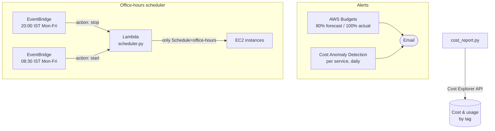

# 03 · AWS FinOps Guardrails

> **Hands-on lab.** A reference build for learning and demonstration, not client code.

Automated cost controls for an AWS account, built with Terraform and Python:

1. **Budget alerts**: email at 80% of forecast spend and at 100% of actual spend.
2. **Cost anomaly detection**: daily alerts when a service's spend jumps unexpectedly.
3. **Office-hours scheduler**: stops tagged EC2 instances at 20:00 IST and starts them at 08:30 IST on weekdays.
4. **Cost-by-tag report**: last month's spend per team or project, as a share of the total.



## What it shows

- **FinOps practices**: forecast-based alerts, anomaly detection, cost allocation by tag.
- **Automation that saves money**: dev and test instances off for about two-thirds of the week.
- **Safe-by-design IAM**: the scheduler can stop or start *only* instances carrying the opt-in tag, enforced by an
  IAM condition, not just by code.

## Layout

```
terraform/            budget, anomaly monitor, scheduler Lambda + EventBridge rules
src/scheduler.py      start/stop logic
scripts/cost_report.py  Cost Explorer report grouped by tag
docs/                 architecture and design decisions
```

## Run it

```bash
cd terraform
cp terraform.tfvars.example terraform.tfvars   # set alert_email
terraform init
terraform apply

# Opt an instance into the schedule
aws ec2 create-tags --resources i-0123456789abcdef0 --tags Key=Schedule,Value=office-hours

# Test the scheduler now instead of waiting for 20:00
aws lambda invoke --function-name ec2-office-hours-scheduler \
  --payload '{"action":"stop"}' --cli-binary-format raw-in-base64-out /dev/stdout

# Cost report (activate the Project tag in Billing -> Cost allocation tags first)
python ../scripts/cost_report.py Project
```

AWS emails a confirmation link for the anomaly subscription. Click it, or no alerts arrive.

## Clean up

```bash
terraform destroy
```

**Cost:** Budgets (first two free), anomaly detection and the scheduler Lambda cost close to nothing.
Cost Explorer API calls are $0.01 each.

See [docs/ARCHITECTURE.md](docs/ARCHITECTURE.md) for design decisions.
