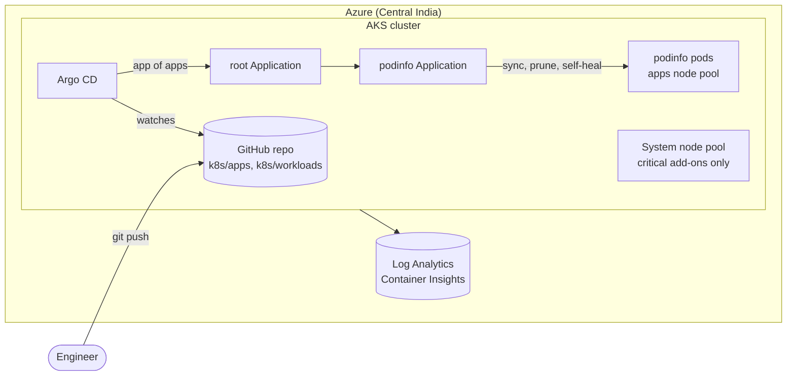

# 04 · Azure AKS with GitOps (Argo CD)

> **Hands-on lab.** A reference build for learning and demonstration, not client code.

An Azure Kubernetes Service cluster built with Terraform, with Argo CD deploying workloads straight from this
Git repository. Git is the single source of truth: change a file, push, and the cluster follows.



## What it shows

- **Terraform on Azure**: resource group, VNet, Log Analytics and AKS with separate system and user node pools.
- **GitOps with Argo CD**: an *app of apps* pattern with automated sync, pruning and self-healing.
- **Security**: workload identity (OIDC), Azure Policy add-on, Calico network policies, non-root containers.
- **Operations**: Container Insights logs, node pool autoscaling, surge upgrades.

## Layout

```
terraform/                 AKS, VNet, Log Analytics
helm/argocd-values.yaml    Argo CD install settings
k8s/root-app.yaml          the one Application you apply by hand
k8s/apps/                  Applications managed by the root app
k8s/workloads/podinfo/     the workload itself
docs/                      architecture and design decisions
```

## Run it

```bash
az login
export ARM_SUBSCRIPTION_ID=$(az account show --query id -o tsv)

cd terraform
terraform init
terraform apply
$(terraform output -raw get_credentials)

helm repo add argo https://argoproj.github.io/argo-helm
helm install argocd argo/argo-cd -n argocd --create-namespace -f ../helm/argocd-values.yaml

kubectl apply -f ../k8s/root-app.yaml       # from here on, Git drives the cluster
kubectl -n argocd get applications
```

Open the Argo CD UI:

```bash
kubectl -n argocd port-forward svc/argocd-server 8080:80
kubectl -n argocd get secret argocd-initial-admin-secret -o jsonpath='{.data.password}' | base64 -d
```

Try GitOps: edit `PODINFO_UI_MESSAGE` in `k8s/workloads/podinfo/podinfo.yaml`, push, and watch Argo CD roll it out.
Delete the Deployment by hand and watch self-heal recreate it.

## Clean up

```bash
kubectl delete -f ../k8s/root-app.yaml
terraform destroy
```

**Cost:** the AKS control plane is free on the Free tier; you pay for the VMs (about 3 small nodes) and Log Analytics ingestion.

See [docs/ARCHITECTURE.md](docs/ARCHITECTURE.md) for design decisions.
