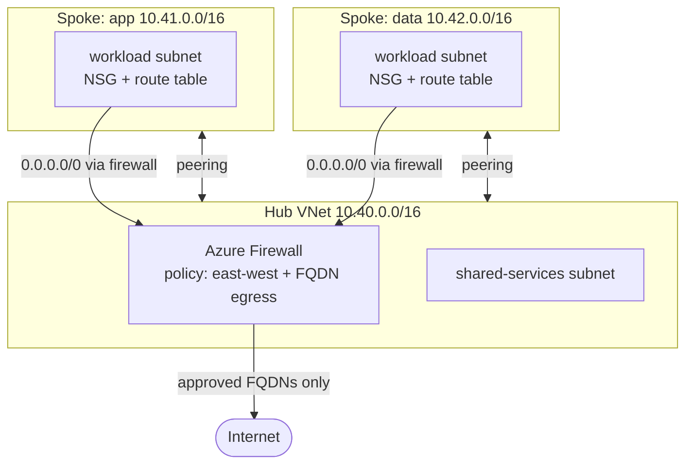

# 05 · Azure Hub-and-Spoke Network

> **Hands-on lab.** A reference build for learning and demonstration, not client code.

The standard enterprise network layout on Azure, built with Terraform: a **hub** VNet holds shared services and an
optional **Azure Firewall**; **spoke** VNets hold workloads and connect only through the hub.



## What it shows

- **Network segmentation**: spokes are never peered with each other. Spoke-to-spoke traffic must pass the firewall.
- **Central egress control**: outbound internet is limited to an allow-list of domains (FQDN rules).
- **Defence in depth**: NSGs on every workload subnet, plus firewall rules, plus routing.
- **Reusable Terraform**: add a spoke by adding one entry to the `spokes` map.
- **Cost switch**: `deploy_firewall = false` (the default) builds the network for free; set it to `true` for the full design.

## Layout

```
terraform/   hub, spokes, peering, NSGs, firewall + policy, route tables
docs/        architecture, traffic flows, design decisions
```

## Run it

```bash
az login
export ARM_SUBSCRIPTION_ID=$(az account show --query id -o tsv)

cd terraform
terraform init
terraform apply                              # network only, no firewall cost
terraform apply -var deploy_firewall=true    # full design with Azure Firewall
```

Add a third spoke without touching any resource code:

```bash
terraform apply -var 'spokes={app={address_space="10.41.0.0/16",workload_prefix="10.41.1.0/24"},data={address_space="10.42.0.0/16",workload_prefix="10.42.1.0/24"},shared={address_space="10.43.0.0/16",workload_prefix="10.43.1.0/24"}}'
```

## Clean up

```bash
terraform destroy
```

**Cost:** VNets, peering setup, NSGs and route tables are free (peering traffic is billed per GB).
Azure Firewall Standard costs about USD 1.25 per hour, so destroy it when not in use.

See [docs/ARCHITECTURE.md](docs/ARCHITECTURE.md) for traffic flows and design decisions.
