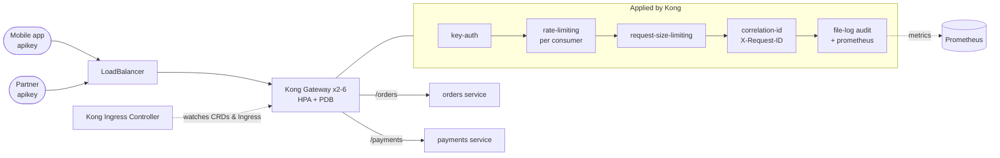

# 06 · Kong API Gateway on Kubernetes

> **Hands-on lab.** A reference build for learning and demonstration, not client code.

Kong Gateway with the **Kong Ingress Controller (KIC)** in DB-less mode, managing two backend services as one
governed API. All gateway configuration is Kubernetes YAML: plugins, consumers and routes.



## What it shows

- **API governance**: key authentication, per-consumer rate limits (stricter on payments) and payload limits.
- **Auditing**: every request logged as JSON with consumer, route, status and latency, plus a request ID.
- **Observability**: Prometheus metrics for status codes, latency and bandwidth, per consumer.
- **Gateway resilience**: 2–6 Kong replicas with an HPA and a PodDisruptionBudget.
- **Config as code**: plugins (`KongPlugin`, `KongClusterPlugin`), consumers (`KongConsumer`) and routes (`Ingress`).

## Layout

```
helm/kong-values.yaml   Kong + KIC install settings
k8s/01-backend.yaml     orders and payments services
k8s/02-plugins.yaml     auth, rate limits, size limit, request IDs, metrics, audit log
k8s/03-consumers.yaml   API consumers and their keys
k8s/04-routes.yaml      Ingress routes with per-route plugins
docs/                   architecture and design decisions
```

## Run it

```bash
helm repo add kong https://charts.konghq.com
helm install kong kong/ingress -n kong --create-namespace -f helm/kong-values.yaml

kubectl apply -f k8s/
PROXY=$(kubectl -n kong get svc kong-gateway-proxy -o jsonpath='{.status.loadBalancer.ingress[0].ip}')
```

Try it:

```bash
curl -i http://$PROXY/orders                                       # 401: no key
curl -i http://$PROXY/orders -H 'apikey: demo-mobile-key-change-me' # 200, with X-Request-ID
for i in $(seq 1 12); do
  curl -s -o /dev/null -w '%{http_code}\n' http://$PROXY/payments -H 'apikey: demo-partner-key-change-me'
done                                                               # 429 after 10 per minute

kubectl -n kong logs deploy/kong-gateway | grep '"consumer"'        # audit log lines
```

On a local cluster (kind or minikube) without a load balancer, use
`kubectl -n kong port-forward svc/kong-gateway-proxy 8000:80` and `localhost:8000`.

## Clean up

```bash
kubectl delete -f k8s/
helm uninstall kong -n kong
```

See [docs/ARCHITECTURE.md](docs/ARCHITECTURE.md) for design decisions.
