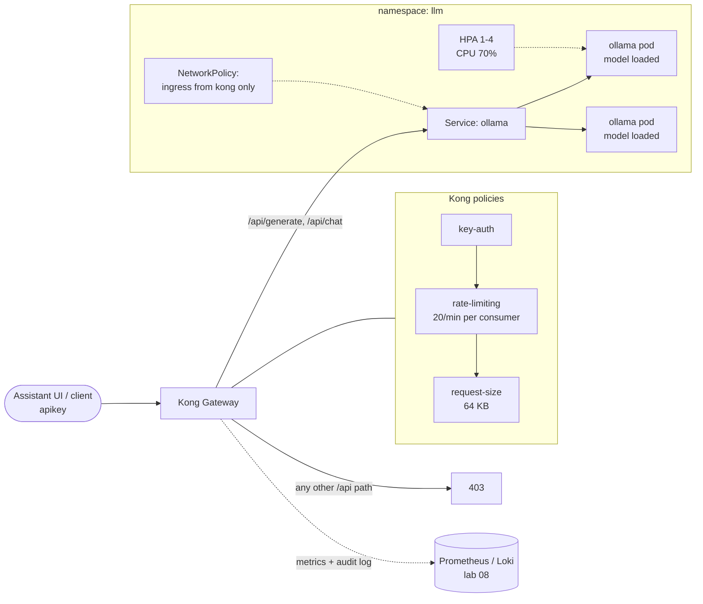

# 07 · LLM Inference Platform on Kubernetes

> **Hands-on lab.** A reference build for learning and demonstration, not client code.

A self-hosted large language model (Ollama serving `llama3.2:1b`) on Kubernetes, governed by Kong:
API keys, per-consumer rate limits, prompt size limits and an allow-list of endpoints. The model scales with
load, and nothing can reach it except through the gateway.



## What it shows

- **Containerised LLM inference** with start-up, readiness and liveness probes tuned for model loading.
- **Autoscaling and self-healing**: an HPA with slow scale-down (new replicas need minutes to load the model) and a PDB.
- **API governance with Kong**: who can call the model, how often, and with how large a prompt.
- **Attack-surface reduction**: model-management endpoints (`/api/pull`, `/api/delete`) are blocked at the gateway,
  and a NetworkPolicy blocks every path that bypasses Kong.

## Layout

```
k8s/01-ollama.yaml    model server: Deployment, Service, HPA, PDB, NetworkPolicy
k8s/02-gateway.yaml   Kong plugins, consumer, allowed and blocked routes
scripts/ask.py        command-line client that goes through Kong
docs/                 architecture and design decisions
```

## Run it

Requires Kong from [lab 06](../06-kong-gateway-kubernetes) and nodes with about 4 CPUs and 6 GB of free memory.

```bash
kubectl apply -f k8s/
kubectl -n llm get pods -w            # wait until READY 1/1 (model download)

export LLM_URL=http://$(kubectl -n kong get svc kong-gateway-proxy -o jsonpath='{.status.loadBalancer.ingress[0].ip}')
export LLM_API_KEY=demo-assistant-key-change-me
python scripts/ask.py "What does a Kubernetes readiness probe do?"

curl -i -X POST $LLM_URL/api/pull -H "apikey: $LLM_API_KEY"   # 403: blocked at the gateway
```

## Clean up

```bash
kubectl delete -f k8s/
```

See [docs/ARCHITECTURE.md](docs/ARCHITECTURE.md) for design decisions.
