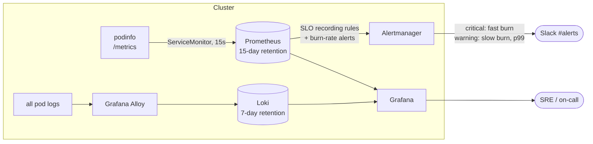

# 08 · Kubernetes Observability Stack with SLO Alerting

> **Hands-on lab.** A reference build for learning and demonstration, not client code.

Metrics, logs, dashboards and alerts for a Kubernetes cluster, plus an **SLO with error-budget burn-rate alerts**
for a sample service: the alerting approach from the Google SRE Workbook.



## What it shows

- **Full observability stack**: kube-prometheus-stack (Prometheus, Alertmanager, Grafana, node and kube-state
  metrics), Loki for logs, Alloy as the log collector.
- **SRE practice**: a 99.9% availability SLO, recording rules for four time windows, and multi-window burn-rate alerts
  that page for fast burns and open tickets for slow ones.
- **Dashboards as code**: a Grafana dashboard in a ConfigMap, loaded automatically, showing availability,
  error budget left, traffic, burn rate and latency.
- **No secrets in Git**: the Grafana admin password and Slack webhook come from Kubernetes Secrets.

## Layout

```
helm/kube-prometheus-stack-values.yaml   Prometheus, Grafana, Alertmanager (Slack routing)
helm/loki-values.yaml                    Loki single binary
helm/alloy-values.yaml                   log collection pipeline
k8s/01-sample-app.yaml                   podinfo + ServiceMonitor
k8s/02-slo-rules.yaml                    SLO recording rules and alerts
k8s/03-dashboard.yaml                    Grafana dashboard
docs/                                    architecture, SLO maths, design decisions
```

## Run it

```bash
kubectl create namespace monitoring
kubectl -n monitoring create secret generic grafana-admin \
  --from-literal=admin-user=admin --from-literal=admin-password='choose-a-strong-one'
kubectl -n monitoring create secret generic alertmanager-slack --from-literal=url='https://hooks.slack.com/services/...'

helm repo add prometheus-community https://prometheus-community.github.io/helm-charts
helm repo add grafana https://grafana.github.io/helm-charts
helm install kps prometheus-community/kube-prometheus-stack -n monitoring -f helm/kube-prometheus-stack-values.yaml
helm install loki grafana/loki -n monitoring -f helm/loki-values.yaml
helm install alloy grafana/alloy -n monitoring -f helm/alloy-values.yaml

kubectl apply -f k8s/
kubectl -n monitoring port-forward svc/kps-grafana 3000:80     # open http://localhost:3000
```

Make the SLO alert fire: podinfo returns errors on `/status/500`.

```bash
kubectl -n shop run errors --rm -it --image=busybox:1.36 -- \
  sh -c 'while true; do wget -qO- http://podinfo:9898/status/500; done'
```

## Clean up

```bash
kubectl delete -f k8s/
helm uninstall alloy loki kps -n monitoring
kubectl delete namespace monitoring
```

See [docs/ARCHITECTURE.md](docs/ARCHITECTURE.md) for the SLO maths and design decisions.
