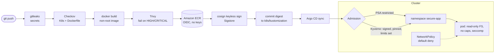

# 09 · Kubernetes DevSecOps Pipeline

> **Hands-on lab.** A reference build for learning and demonstration, not client code.

Security built into every step from commit to running pod: secret scanning, IaC scanning, image CVE scanning,
keyless image signing, GitOps deployment by digest, and cluster admission policies that reject anything that
skipped those steps.



## What it shows

- **Shift-left security**: secrets, misconfigurations and vulnerable packages fail the build before anything ships.
- **Supply-chain security**: images are signed keylessly with Sigstore, and the cluster only runs images signed
  by this pipeline (Kyverno `verifyImages`).
- **No long-lived credentials**: GitHub OIDC to AWS; no access keys stored in CI.
- **GitOps by digest**: deploys pin an immutable `@sha256` digest, never a moving tag.
- **Runtime hardening**: Pod Security Admission `restricted`, non-root, read-only root filesystem, dropped
  capabilities, seccomp, no service-account token, default-deny NetworkPolicies.

## Layout

```
app/                         tiny Python service + hardened Dockerfile
pipeline/github-actions.yml  the CI/CD pipeline (copy into .github/workflows/ of an app repo)
k8s/                         namespace (PSA), deployment, network policies, kustomization
k8s/policies/                Kyverno admission policies
docs/                        architecture, threat model, design decisions
```

## Run it

Local check of the hardened image:

```bash
docker build -t secure-app:dev app/
docker run --rm -p 8080:8080 --read-only --cap-drop ALL secure-app:dev
curl localhost:8080/healthz
```

In a cluster with Kyverno installed:

```bash
helm repo add kyverno https://kyverno.github.io/kyverno/
helm install kyverno kyverno/kyverno -n kyverno --create-namespace
kubectl apply -f k8s/policies/

# Try to break the rules; both are rejected at admission:
kubectl run bad --image=nginx:latest                       # latest tag
kubectl -n secure-app run root --image=nginx:1.27          # restricted profile + unsigned image
```

The full pipeline needs an AWS account (an ECR repository and an IAM role trusted for GitHub OIDC) and Argo CD
(see [lab 04](../04-azure-aks-gitops)).

See [docs/ARCHITECTURE.md](docs/ARCHITECTURE.md) for the threat model and design decisions.
