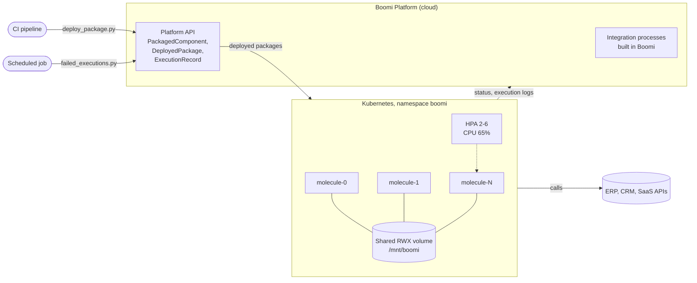

# 10 · Boomi Molecule on Kubernetes with API-driven Deployments

> **Hands-on lab.** A reference build for learning and demonstration, not client code.

Running the **Boomi Molecule** (Boomi's clustered integration runtime) on Kubernetes, and operating it like any
other platform: autoscaling, graceful shutdown, shared storage, deployments from CI through the Boomi Platform
API, and automated failure reporting.



## What it shows

- **Integration runtime on Kubernetes**: a StatefulSet Molecule with stable node IDs, shared storage and
  anti-affinity across hosts.
- **Graceful operations**: 15-minute termination grace so in-flight processes finish, slow scale-down,
  and a PodDisruptionBudget.
- **Boomi CI/CD**: package a component and deploy it to an environment from the command line or a pipeline.
- **Monitoring**: a job that lists failed executions and exits non-zero, so a CronJob or CI schedule can alert on it.

## Layout

```
k8s/01-molecule.yaml          namespace, token Secret, RWX volume, StatefulSet, HPA, PDB
scripts/boomi_api.py          small Platform API client (API-token auth)
scripts/deploy_package.py     package + deploy a component
scripts/failed_executions.py  failed executions in the last N hours
docs/                         architecture and design decisions
```

## Run it

Requirements: a Boomi account with Molecule entitlement, an installer token, and a `ReadWriteMany` storage class
(named `shared-nfs` here; for example EFS on EKS or Azure Files on AKS).

```bash
# Set the real installer token and environment ID first (never commit them)
kubectl apply -f k8s/01-molecule.yaml
kubectl -n boomi get pods -w          # nodes register with the Boomi platform
```

Deploy and monitor through the API:

```bash
export BOOMI_ACCOUNT_ID=<account id>
export BOOMI_USERNAME=<login email>
export BOOMI_API_TOKEN=<platform API token>

python scripts/deploy_package.py --component <componentId> --environment <environmentId> \
  --version 1.0.0 --notes "First release"
python scripts/failed_executions.py --hours 24
```

## Clean up

```bash
kubectl delete -f k8s/01-molecule.yaml
```

Then delete the Molecule from Runtime Management in Boomi so it stops counting against your licence.

> The image tag, environment variables and probe paths follow Boomi's published Kubernetes reference. Boomi updates
> these between releases, so check them against the current Boomi documentation before using this beyond a lab.

See [docs/ARCHITECTURE.md](docs/ARCHITECTURE.md) for design decisions.
